# MotorPhen

<p align="center">
  
</p>

Motor phenotyping from markerless gait recordings. The aim is a small, open
implementation of a normative gait model: train on healthy walking, score each
joint by how far it departs from what the model expects, and reconstruct a
subject-specific normative trajectory. Joint-level outputs are meant to be
compared across genetically defined patient groups.

The model design follows GenGait, the masked autoencoder approach described by
Motta et al. [1]. Their code and data are not public; this is an independent
reimplementation from the published description, not their software.

## Status

The reimplementation has been trained on 110 able-bodied adults from a public
motion capture dataset [2] and evaluated on
held-out healthy adults and on 50 stroke survivors whose paretic side is known.
Results are exploratory and come from our implementation of the published
description, with marker-based rather than markerless input.

- E1, specificity in held-out healthy adults: `results/e1/README.md`
- E2, paretic side in stroke survivors: `results/e2/README.md`
- E3, inference choices, age range of the reference, window length and
  training size: `results/e3/`
- Short summary of E1 and E2: `docs/summary-e1-e2.md`

Details the paper leaves open are our choices, listed in
`docs/e1-implementation-spec.md`.

## Model and training

This is not a language model. It is a small encoder-decoder Transformer
(10.0 M parameters, PyTorch) trained as a masked autoencoder on joint angles
from healthy walking, with no disease labels.

- Input: a window of 7 frames at 30 Hz for 12 joints (neck, pelvis, shoulders,
  elbows, hips, knees, ankles), giving 84 joint-frame tokens. Each token has 12
  features: sine and cosine of the three Cardan angles, and the first two
  columns of the rotation matrix (6D rotation representation).
- Embeddings: a linear projection of the features plus learned joint and frame
  embeddings, a sinusoidal positional code and an embedding of angular velocity
  within the window. Velocity is set to zero wherever the current or previous
  token is hidden, so masked values cannot leak into the context.
- Architecture: 8 encoder layers and 2 decoder layers, model dimension 288,
  12 attention heads, feed-forward width 1152, dropout 0.1, with separate
  learned mask tokens for the encoder and the decoder (`src/motorphen/model.py`).
- Masking curriculum: random joint dropout (each joint hidden with probability
  0.5 per frame) for the first 5 epochs, then a rising share of structured
  masks (a whole limb, one joint or a pair of joints) that reaches 90% at epoch
  60. Masks are held constant over a random span of frames so that the model
  also learns temporal gaps (`src/motorphen/masking.py`).
- Loss: five equally weighted L1 terms on the sine-cosine features, for the
  last frame, the masked tokens, the visible tokens, frame-to-frame velocity,
  and agreement of the last-frame prediction under two different masks
  (`src/motorphen/train.py`).
- Optimisation: AdamW (learning rate 2e-4, betas 0.9 and 0.95, weight decay
  0.05 except on biases, norms and mask tokens), gradient clipping at 1.0,
  batch 256 (accumulated over micro-batches for longer windows), 250 epochs over
  25,760 training windows from 110 participants. Participants are split into
  train, validation and test sets with a fixed seed, never trials.
- Inference: two passes. Pass 1 predicts each window with nothing hidden, then
  with each of six joints hidden in turn, and scores a joint by how much its
  prediction changes (orientation of the segment long axis and range-of-motion
  normalised angle change). Joints whose 95th percentile score exceeds a noise
  floor calibrated on validation participants are flagged, at most two. Pass 2
  hides only the flagged joints and reconstructs them from the rest of the
  body (`src/motorphen/inference.py`).

Compute. Each 7-frame run took 53 minutes on one NVIDIA RTX 5090 (PyTorch
2.11, CUDA 12.8), with peak GPU memory of 9.55 GB. Longer windows cost more,
since attention grows with the square of the token count: 15 frames (180
tokens) took about 4 hours and 31 frames (372 tokens) 4 to 8 hours at
micro-batch 64. The same code runs on Apple MPS and CPU for development and
inference; `src/motorphen/memcap.py` stops a run cleanly if process and GPU
memory pass a set limit. See `docs/compute.md`.

Reproducibility. Each training run writes a JSON record with the seed, split
seed, MD5 of the processed data, PyTorch and Python versions, git commit, GPU
and peak memory, plus a per-epoch log of every loss term (`results/*/run_*.json`,
`results/*/train_log_*.tsv`). Validation uses fixed masks so that losses are
comparable across epochs. Every model was trained twice with different seeds,
and differences between runs are reported as the noise baseline for any
comparison. Package versions are pinned in `requirements.txt` and
`requirements-gpu.txt`, and `pytest` runs 29 unit tests covering the token
features, masking, windowing, inference and baselines.

Evaluation. Statistics are at the level of participants, not windows or
trials: bootstrap confidence intervals over participants, exact McNemar tests,
and paired comparison of AUROCs by bootstrap and DeLong's test against simple
clinical rules and deviation-from-normal baselines (`src/motorphen/baselines.py`,
`scripts/09_compare_auroc_e2.py`).

## Trained models

The two E1 models (7-frame window, 110 training participants, seeds 1 and 2)
are attached to the GitHub release
[v0.0.1](https://github.com/taowis/motorphen/releases/tag/v0.0.1) as
`motorphen_e1_seed1.pt` and `motorphen_e1_seed2.pt` (40 MB each, SHA-256 sums in
the release notes). Each file holds the `state_dict` and the run record:

```python
import torch
from motorphen.model import GaitMAE

ck = torch.load("motorphen_e1_seed1.pt", map_location="cpu", weights_only=False)
model = GaitMAE()
model.load_state_dict(ck["model"])
model.eval()
```

Scoring also needs the range of motion and noise floor used here,
`results/e1/rom_deg.tsv` and `results/e1/noise_floor_seed<N>.tsv`, and the
normative mean for evaluation, `results/e1/normative_mean.tsv`. The models were
trained on marker-based Plug-in Gait angles resampled to 30 Hz and have not been
tested on markerless input. They are research models, not for clinical use.

## Layout

- `src/motorphen/` package code
- `scripts/` data preparation and training runs
- `tests/` unit tests
- `docs/` design notes
- `data/` see `data/README.md`; raw data is not committed
- `results/` small summary outputs

The figure at the top is built by `scripts/make_readme_figure.py` from the
numbers in the results READMEs; its curves and token scores are illustrative.

No patient data goes into this repository.

## License

The code is released under the MIT License; the full text is in `LICENSE`. The
gait data are not part of this repository; their source and licence are given in
`data/README.md`.

## References

1. Motta E, Lorenzini M, Mouawad C, Ranavolo A, Serrao M, Ajoudani A. GenGait:
   a Transformer-based model for human gait anomaly detection and normative
   twin generation. Artif Intell Med 2027;183:103545.
   https://doi.org/10.1016/j.artmed.2026.103545
2. Van Criekinge T, Saeys W, Truijen S, Vereeck L, Sloot LH, Hallemans A. A
   full-body motion capture gait dataset of 138 able-bodied adults across the
   life span and 50 stroke survivors. Sci Data 2023;10:852.
   https://doi.org/10.1038/s41597-023-02767-y
